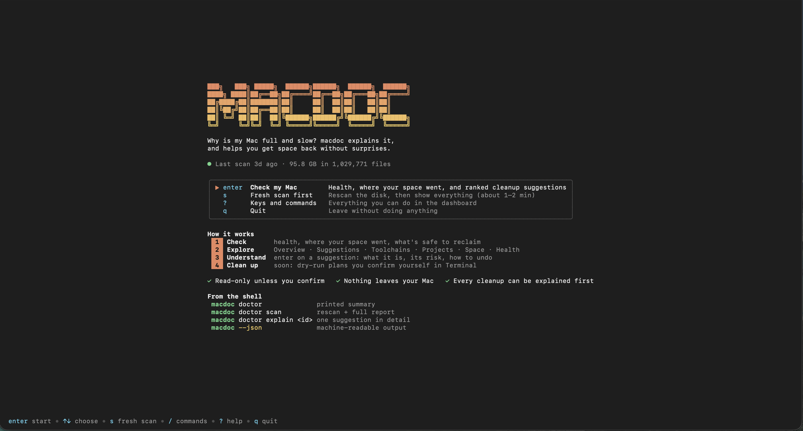

# macdoc

**Find out why your developer Mac is full or slow, and get the space back without surprises.**

macdoc is a command-line tool for macOS. It reads your disk and memory, explains where the space went (Xcode, Android, Node, Docker, Python, Homebrew, local AI models and more), and proposes cleanups. It removes something only after you confirm it in your terminal.

> **Status: early release.** The core commands work. Expect rough edges, and see [`docs/DEVELOPMENT_PLAN.md`](docs/DEVELOPMENT_PLAN.md) for what's planned.



## Why it's safe

- **Read-only by default.** Scans, reports and plans change nothing on your Mac.
- **Removal needs you.** `macdoc apply` asks for a typed confirmation at a real terminal. No flag skips it.
- **Only known cleanups.** Every action comes from a reviewed recipe, using a command the tool itself lists. macdoc never runs a shell or `sudo`.
- **Protected folders stay protected.** Documents, Desktop, iCloud, Mail, Messages, Photos, Keychains and similar locations are never touched. You can add more in `macdoc config`.
- **Recoverable.** Removed items go through a quarantine step, every change is in an audit log, and `macdoc quarantine restore` brings things back.
- **No network.** macdoc doesn't send anything anywhere. See [`PRIVACY.md`](PRIVACY.md).

## Architecture

macdoc has two halves that never mix. The **read path** scans the disk and explains what it finds, and changes nothing. The **write path** runs only after a person confirms a sealed plan, and only `internal/executor` can delete or move anything.

```
  disk                              Mac state (memory, swap, disk)
   │                                          │
 scanner ──► store (SQLite) ◄──────────── probe
               │   ▲
               │   └── recipes (YAML catalog + detectors)
               ▼
            engine  ◄── projects, precond, safety, config
            │     │
   ┌────────┘     └────────┐
   ▼                       ▼
 cli (commands, dashboard)  mcp (Claude: read and propose)
   │
   ▼ plan (IDs only, sealed)
 planner ──► store (plans)
   │
   ▼ apply (typed confirmation at a terminal)
 executor ──► quarantine (move aside, restorable)  or  a fixed native command
   │
   └──► audit (audit.jsonl)
```

### Codebase structure

```
cmd/macdoc/                 entry point (main.go)
internal/
  cli/                      Cobra commands, output, the Bubble Tea dashboard
  engine/                   analysis shared by cli and mcp
  mcp/                      MCP server for Claude (read and propose only)
  planner/                  plan building, sealing, verification
  executor/                 the only package that deletes, moves or runs commands
  scanner/                  bounded-memory crawl of the Data volume
  probe/                    memory, swap, disk and snapshot readings
  projects/                 developer projects and how long they've been idle
  recipes/                  cleanup catalog (YAML, 49 recipes) and detectors
  store/                    SQLite persistence and migrations
  safety/                   protected-path policy and path checks
  precond/                  recipe preconditions, checked just before acting
  quarantine/               read-only view of quarantined items
  audit/                    append-only JSON-lines change log
  config/                   settings file and folder protection
  sandbox/                  MACDOC_SANDBOX, which confines tests
  platform/                 macOS command runner (real and fake), cgo shim
  textsafe/                 cleans disk-sourced text before display or model use
  fsread/                   capped reads of small files
  model/                    shared types
  testutil/fstree/          fake home trees for tests
tools/forbidcheck/          command wrapper; the checker is in tools/forbidcheck/check
scripts/                    importcheck.sh and forbidcheck.sh
schema/                     frozen JSON Schemas, one per --json output
docs/                       design, safety model, checkpoints, architecture
```

Each package keeps its tests in `internal/<package>/tests/` as `package tests`.

### Module guide

Each file covers one part of the code, with the packages involved, the rules they follow and where to look.

| Guide | Covers |
|---|---|
| [Principles and layers](docs/architecture/01-principles-and-layers.md) | The design principles, the import graph and the layers, and the rules CI enforces |
| [Data stores](docs/architecture/02-data-stores.md) | The SQLite tables, plan files, quarantine folders and the audit log |
| [Read path](docs/architecture/03-read-path.md) | The scanner, the probes, project discovery, opportunities and engine views |
| [Recipes](docs/architecture/04-recipes.md) | What a recipe is, its fields, and the detectors |
| [Plans](docs/architecture/05-plans.md) | Building, sealing, verifying and locking a plan |
| [Write path](docs/architecture/06-write-path.md) | `apply`, the per-item pipeline, restore and purge |
| [Safety](docs/architecture/07-safety.md) | Every safety layer and what it stops |
| [Interfaces](docs/architecture/08-interfaces.md) | The CLI commands, the dashboard and the MCP tools |
| [Configuration](docs/architecture/09-configuration.md) | The settings file and folder protection |
| [Platform access](docs/architecture/10-platform.md) | How macOS commands are run, and the fakes used in tests |
| [Testing](docs/architecture/11-testing.md) | Test layout, the sandbox, red-team and contract tests |
| [Build, CI and release](docs/architecture/12-build-and-release.md) | Make targets, CI jobs and version stamping |
| [Extending macdoc](docs/architecture/13-extending.md) | Adding a recipe, detector, command or MCP tool |
| [Module reference](docs/architecture/14-module-reference.md) | Every package, its size, key files and exported surface |

## Install

Requirements: macOS (Apple Silicon or Intel) and Go 1.27 or newer (`brew install go`).

```bash
git clone https://github.com/sagnik26/macdoc.git
cd macdoc
make install                 # builds and copies macdoc to ~/.local/bin
macdoc version
```

Make sure `~/.local/bin` is on your `PATH`, or install elsewhere with `make install BINDIR=/usr/local/bin`. To remove it, run `make uninstall`.

## Use

```bash
macdoc                       # interactive dashboard (scans the first time)
macdoc doctor               # short summary, printed
macdoc doctor scan          # fresh scan and the full report
macdoc doctor explain <id>  # details about one suggestion
```

To clean up:

```bash
macdoc plan                 # make a sealed dry run from suggestion IDs (changes nothing)
macdoc apply <P-id>         # carry out a plan, after you confirm each item in the terminal
macdoc log                  # what macdoc has changed
macdoc quarantine           # see, restore or purge what apply moved aside
```

Other commands:

- `macdoc config`: timeouts, and extra folders to protect.
- `macdoc schedule enable|disable`: a daily read-only scan. macdoc writes the launchd file; you load it with the `launchctl` line it prints.
- `macdoc completion zsh|bash|fish`: shell completion.
- `--json` on most commands gives output against a versioned schema in [`schema/`](schema/).

In the dashboard, `space` marks suggestions, `enter` removes one (press it again to confirm), and `?` lists the keys.

## Use it with Claude

```bash
claude mcp add macdoc -- macdoc mcp
```

Claude can then read your scan results and propose cleanup plans. It can't apply them: you still run `macdoc apply` yourself.

## Contribute

Read [`CONTRIBUTING.md`](CONTRIBUTING.md) first. In short:

```bash
make build      # build ./bin/macdoc
make test       # tests, with the race detector
make lint       # golangci-lint (install it with brew first)
make check      # test, lint, importcheck and forbidcheck, all together
make cover      # coverage across packages
```

- **Tests** live in `internal/<package>/tests/` as `package tests`, and use only exported names.
- **Adding a recipe** means a YAML file in `internal/recipes/catalog/` and three tests: positive, look-alike negative, and precondition failure. See [`docs/RECIPE_CATALOG.md`](docs/RECIPE_CATALOG.md).
- **Safety rules** (for example, only `internal/executor` may delete or move files) are checked by `make importcheck` and `make forbidcheck`. They're listed in [`AGENTS.md`](AGENTS.md).

Report security problems privately, as described in [`SECURITY.md`](SECURITY.md).

## License

MIT. See [`LICENSE`](LICENSE).
